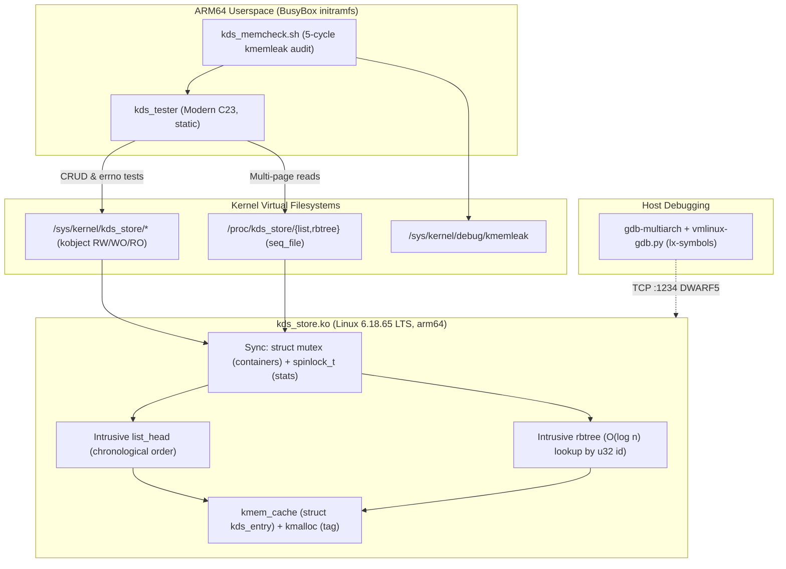

# p04-arm64-lkm-datastructures

Out-of-tree **ARM64 Linux Kernel Module (LKM)** engineered for
**Linux 6.18.65 LTS** on **QEMU `arm64 virt` (SMP)**, demonstrating kernel
dynamic memory management (`kmem_cache` slab allocator + `kmalloc`), dual
intrusive containers (`list_head` and `rbtree`), SMP synchronization,
paginated `procfs` (`seq_file`), `sysfs` (`kobject`), a **Modern C (C23)**
verification suite, `kmemleak` auditing, and live kernel debugging with
`gdb-multiarch`.

## Architecture Overview



## Key Engineering Highlights

- **Dual Intrusive Containers:** Every `struct kds_entry` lives in both
  `struct list_head` (insertion order) and `struct rb_node` (sorted by unique
  `u32 id`) without duplicating heap allocations.
- **Two-Tier Kernel Memory Lifecycle:** Fixed-size `struct kds_entry` nodes
  are served from a dedicated `SLAB_HWCACHE_ALIGN` `kmem_cache`, while
  variable-length tags use `kmalloc`/`kfree` with pre-allocation outside locks
  during in-place updates.
- **SMP-Safe Synchronization:** Enforces strict lock ordering
  (`store->lock` mutex before `store->stats_lock` spinlock) verified with
  `lockdep_assert_held()`, plus `list_splice_init()` bulk teardown outside the
  mutex.
- **Concurrency-Safe `seq_file` Cursor:** `/proc/kds_store/rbtree` uses a
  key-based `O(log n)` lower-bound cursor (`id + 1`) instead of an ordinal
  index, preventing duplicate or out-of-order reads under concurrent SMP
  mutations.
- **Defensive `sysfs` Input Validation:** Rejects embedded NUL bytes, trailing
  garbage tokens, invalid tag characters (`[A-Za-z0-9_.-]` allowlist), and
  overflows with exact kernel `errno` values (`-EINVAL`, `-ERANGE`, `-E2BIG`,
  `-ENAMETOOLONG`, `-EEXIST`, `-ENOSPC`, `-EBUSY`, `-ENOENT`).
- **Modern C23 Test Suite & Zero-Leak Audit:** Cross-compiled static `aarch64`
  suite (`-std=c23 -Wall -Wextra -Wpedantic -Werror`) covering CRUD, 10
  negative `errno` cases, 512-entry multi-page `seq_file` stress, 4-thread SMP
  concurrency, and multi-cycle `kmemleak` verification.

## Repository Layout

```text
p04-arm64-lkm-datastructures/
├── .clangd                 # Scoped clangd rules (kernel arm64 vs C23)
├── .gitignore              # Excludes Kbuild, QEMU, initramfs, and build/
├── Makefile                # Master orchestration (all, check, demo, gdb)
├── README.md               # Project documentation
├── kernel/
│   └── debug_lkm.fragment  # Kconfig fragment (DWARF5, GDB_SCRIPTS, KMEMLEAK)
├── module/
│   ├── .clang-format       # Upstream Linux kernel formatting rules
│   ├── Makefile            # Out-of-tree Kbuild composite module build
│   ├── kds_store.h         # Data structures, stats, and internal API
│   ├── kds_core.c          # Slab allocator, list_head, rbtree, CRUD, locks
│   ├── kds_main.c          # Module init/exit, module_param, boot selftest
│   ├── kds_procfs.c        # Paginated seq_file views (list and rbtree)
│   └── kds_sysfs.c         # kobject attributes and defensive command parser
├── rootfs/
│   ├── init                # Minimal BusyBox init (proc, sysfs, debugfs, demo)
│   └── kds_memcheck.sh     # Multi-cycle insmod/rmmod + kmemleak verifier
├── scripts/
│   ├── run_qemu.sh         # QEMU arm64 virt runner (normal, --debug, --demo)
│   ├── attach_gdb.sh       # gdb-multiarch launcher with vmlinux-gdb.py
│   └── kds_debug.gdb       # Custom GDB commands using $container_of
└── userspace/
    ├── Makefile            # Static aarch64 C23 cross-build
    └── kds_tester.c        # Functional, errno, seq_file, and SMP test suite
```

## Interfaces Reference

### procfs Endpoints (`/proc/kds_store/`)

| File | Mode | Description |
| :--- | :--- | :--- |
| `/proc/kds_store/list` | `0444` | Paginated `seq_file` dump in insertion order |
| `/proc/kds_store/rbtree` | `0444` | Paginated `seq_file` dump sorted by `id` |

### sysfs Attributes (`/sys/kernel/kds_store/`)

| Attribute | Mode | Format / Behavior |
| :--- | :--- | :--- |
| `add` | `0200` | Write `"<id> <value> <tag>"` to insert a node |
| `update` | `0200` | Write `"<id> <value> [tag]"` to update in place |
| `del` | `0200` | Write `"<id>"` to remove a node |
| `lookup` | `0644` | Write `"<id>"` for `O(log n)` lookup; read snapshot |
| `clear` | `0200` | Write `"1"` to clear all entries safely |
| `max_entries` | `0644` | Read or update capacity limit (`1..65536`) |
| `stats` | `0444` | Read active, alloc, free, update, hit, miss counts |

## Quick Start

### Prerequisites (Debian)

```bash
sudo apt update && sudo apt install -y \
    build-essential gcc-aarch64-linux-gnu binutils-aarch64-linux-gnu \
    qemu-system-arm gdb-multiarch bc bison flex libssl-dev libelf-dev \
    libncurses-dev dwarves cpio rsync kmod xz-utils curl python3 bear clangd
```

### Build and Run the Automated Demo

Assuming `build/kernel` (Linux 6.18.65 with `kernel/debug_lkm.fragment`) and
`build/rootfs` (static BusyBox 1.37.0 `aarch64`) are prepared:

```bash
make check   # Runs checkpatch.pl (0 errors/warnings) and builds all targets
make demo    # Boots QEMU arm64 virt, runs 3 full test+kmemleak cycles, exits
make run     # Boots interactive QEMU shell for manual exploration
make lsp     # Generates compile_commands.json for module/ and userspace/
```

## Live Kernel and LKM Debugging with GDB

Start QEMU paused on `tcp::1234` in **Terminal 1**:

```bash
make debug
```

Attach `gdb-multiarch` with DWARF5 symbols and `vmlinux-gdb.py` in
**Terminal 2**:

```bash
make gdb
```

Inside GDB, continue boot (`continue`), run `insmod /lib/modules/kds_store.ko`
in QEMU, then pause GDB with `Ctrl+C` and inspect the live intrusive
containers:

```gdb
lx-symbols module
source scripts/kds_debug.gdb
kds-info
kds-dump-list
kds-dump-rbroot
break kds_store_add
continue
```

Trigger a live breakpoint from QEMU:

```sh
echo "777 31415 gdb_probe" > /sys/kernel/kds_store/add
```

## Verification Summary

- **Linux Kernel Coding Style:** `checkpatch.pl --no-tree` passes with
  0 errors and 0 warnings across all `module/*.{c,h}` files.
- **Userspace Strictness:** `kds_tester.c` compiles cleanly under `-std=c23`
  with `-Wall -Wextra -Wpedantic -Werror -Wshadow -Wconversion`.
- **Memory Safety:** 0 leaks reported by `/sys/kernel/debug/kmemleak` across
  repeated `insmod -> kds_tester -> rmmod` stress cycles.
